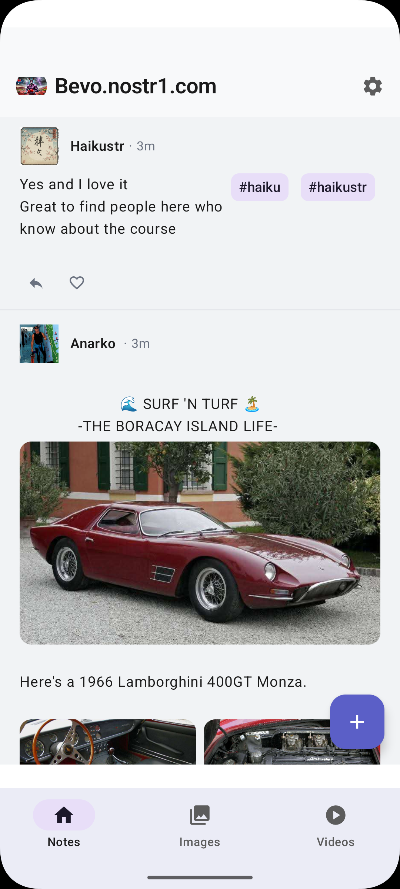

# Chirp

A modern Nostr social media client for Android, built with Jetpack Compose and powered by NDK (Nostr Development Kit).



## Overview

Chirp is a full-featured Nostr client that demonstrates the capabilities of NDK for Android. It provides a seamless social media experience with support for text notes, images, and videos, all following Nostr protocols.

## Features

### Core Functionality
- **Text Notes Feed** - Browse and interact with text notes (kind 1 events)
- **Image Gallery** - View and upload images with Blossom integration
- **Video Feed** - TikTok/Reels-style vertical video scrolling experience
- **Video Recording** - Record and publish videos directly from the app using CameraX
- **Threaded Conversations** - View full conversation threads
- **User Profiles** - View user profiles and their content
- **Search & Hashtags** - Search for hashtags and discover content
- **Compose & Reply** - Create new notes and reply to existing ones

### Advanced Features
- **Blossom Media Server** - Configure and upload media to Blossom servers
- **Relay Management** - Add, remove, and manage Nostr relays
- **Content Filtering** - Filter relays by content type (text, images, videos)
- **Developer Tools** - Monitor relay connections, NostrDB stats, and active subscriptions
- **Blurhash Previews** - Fast image placeholders with blurhash
- **Zoomable Images** - Pinch-to-zoom support for images
- **Reaction & Reply Buttons** - Quick interactions with content

### Onboarding & Authentication
- **Account Creation** - Generate new Nostr keypairs
- **Account Import** - Import existing accounts via nsec or hex private key
- **Multi-Account Support** - Switch between multiple Nostr accounts
- **Secure Storage** - Encrypted key storage using Android Keystore

## Architecture

Chirp follows modern Android development best practices:

### Tech Stack
- **UI**: Jetpack Compose with Material 3
- **Architecture**: MVVM with unidirectional data flow (State/Intent pattern)
- **DI**: Hilt (Dagger)
- **Navigation**: Jetpack Navigation Compose
- **Async**: Kotlin Coroutines and Flow
- **Image Loading**: Coil 3.x
- **Video Playback**: Media3 (ExoPlayer)
- **Camera**: CameraX for video recording
- **Persistence**: DataStore for preferences
- **Networking**: Ktor (for Blossom uploads)
- **Cryptography**: secp256k1-kmp for Nostr signing

### NDK Integration
Chirp uses multiple NDK modules:
- `ndk-core` - Core Nostr protocol implementation
- `ndk-nostrdb` - High-performance local event database
- `ndk-account-android` - Android-specific account management
- `ndk-compose` - Compose utilities for Nostr events

### Project Structure
```
chirp/
├── src/main/kotlin/com/example/chirp/
│   ├── features/           # Feature modules
│   │   ├── home/          # Text notes feed
│   │   ├── images/        # Image gallery
│   │   ├── videos/        # Video feed & recording
│   │   ├── compose/       # Note composition
│   │   ├── thread/        # Thread view
│   │   ├── profile/       # User profiles
│   │   ├── search/        # Search & hashtags
│   │   ├── settings/      # App settings
│   │   ├── onboarding/    # Account setup
│   │   ├── debug/         # Developer tools
│   │   └── relaysets/     # Relay set management
│   ├── components/        # Reusable UI components
│   ├── navigation/        # Navigation setup
│   ├── data/             # Repositories & data layer
│   ├── di/               # Dependency injection modules
│   ├── models/           # Data models
│   ├── ui/theme/         # Theme & styling
│   └── util/             # Utilities
├── src/test/             # Unit tests
└── build.gradle.kts      # Build configuration
```

## Building

### Requirements
- Android Studio Hedgehog or later
- JDK 17+
- Android SDK 26+ (minSdk)
- Android SDK 35 (targetSdk/compileSdk)

### Build Steps
```bash
# From the root ndk-android directory
./gradlew :chirp:assembleDebug

# Install on connected device
./gradlew :chirp:installDebug

# Run tests
./gradlew :chirp:test
```

## Development

### Running the App
1. Open the project in Android Studio
2. Sync Gradle
3. Run the `chirp` module on an emulator or device

### Key Dependencies
See `build.gradle.kts` for the complete dependency list. Notable libraries:
- Jetpack Compose BOM 2024.02.00
- Hilt 2.54
- Coil 3.0.0
- Media3 1.2.1
- CameraX 1.3.1
- Ktor 2.3.7

### Testing
The app includes unit tests using:
- JUnit 4
- Robolectric (for Android framework testing)
- Mockito Kotlin
- Kotlin Coroutines Test

Run tests with:
```bash
./gradlew :chirp:test
```

### End-to-End Testing
Chirp includes Maestro test flows for automated UI testing:
- Image gallery testing (`.maestro/image-gallery-test.yaml`)
- Video upload testing (`.maestro/video-upload-test.yaml`)

## Configuration

### Default Relays
The app connects to these relays by default:
- wss://relay.damus.io
- wss://nos.lol
- wss://relay.nostr.band

You can add/remove relays in Settings → Relay Settings.

### Blossom Servers
Configure Blossom media servers in Settings → Blossom Settings for image and video uploads.

## Privacy & Security
- Private keys are stored encrypted in Android Keystore
- No analytics or tracking
- All communication happens over Nostr relays
- Media uploaded to user-configured Blossom servers

## License
This is a reference implementation for NDK. Check the parent repository for license details.

## Contributing
Chirp serves as a comprehensive example of NDK usage. Contributions that demonstrate additional NDK features or improve the reference implementation are welcome.
